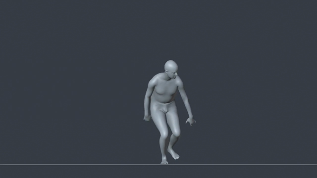
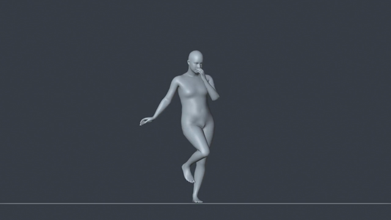
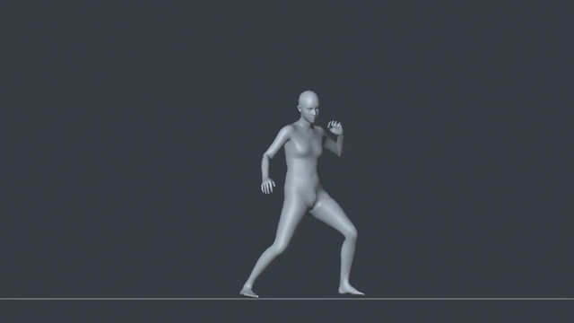
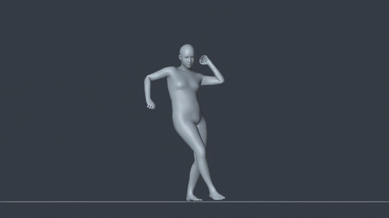

# FlowHMR-Windows

[简体中文](../../README.md) · [繁體中文](zh-TW.md) · **English** · [日本語](ja.md) · [한국어](ko.md) · [Русский](ru.md) · [Français](fr.md)

**FlowHMR-Windows** is an application for capturing motion from video on your own computer. Import a video, select one or more people, and reconstruct their movements in 3D for synchronized preview and export. It uses the upstream [FlowHMR](https://github.com/flowhmr/flowhmr) model for motion reconstruction. This independently maintained repository provides the portable Windows edition, model and runtime management, and the desktop workflow from person selection through export.

**[Download the portable Windows edition](https://github.com/xiaoerofficial021-collab/FlowHMR-Windows/releases/latest/download/FlowHMR-Windows.zip)** · [Release notes](https://github.com/xiaoerofficial021-collab/FlowHMR-Windows/releases/latest) · [FlowHMR paper](https://arxiv.org/abs/2610.03691)

## Windows desktop edition

- **Capture motion in one window.** Choose who to track and which frames to process, then view the source video and the 3D motion side by side. The timeline keeps playback, seeking and loops in sync. Play the original audio and switch between the skinned mesh and skeleton displays.
- **Preview and export multiple people together.** Select several people in one video. The combined preview and FBX preserve their relative positions and when each person enters. Reopen previous jobs from the thumbnail history.
- **Adjust the result to suit the footage.** Tune motion smoothing, foot contact correction and ground height. Enable HaMeR for more detailed finger motion. Fixed camera is the default; use moving camera mode when the camera clearly rotates horizontally, tilts or rolls.
- **Run locally.** Install the inference runtime and model files as needed. Models load when generation starts. Once set up, the app can process videos offline. The interface is available in 简体中文, 繁體中文, English, 日本語, 한국어, Русский and Français. It remembers your language after you close it.
- **Export motion data.** Export NPZ or FBX. FBX can contain an animated skeleton alone or a skinned mesh as well. Optionally add a T Pose or A Pose at frame **−1** while keeping the original motion start frame.

## Companion Blender add-on: FlowHMR 2 MMR

**[Download FlowHMR 2 MMR v1.3.1](https://github.com/xiaoerofficial021-collab/FlowHMR-Windows/releases/latest/download/FlowHMR_2_MMR_v1.3.1.zip)** · Authors: **小二, GPT** · Blender 3.6 or later. The multi-person workflow was verified in 3.6.22 and 4.5.3.

Use the add-on to retarget the exported FBX motion to a control rig generated by **MMR**. For multiple people, pair the rigs, preview the result and bake everything in the same scene. Each target gets its own Action, preserving its entrance time and relative position.

1. In Blender, open **Edit → Preferences → Add-ons** and install the ZIP. In Blender 3.6, click **Install**. In Blender 4.2 or later, choose **Install from Disk** in the upper-right menu. Enable **FlowHMR 2 MMR**, then press **N** in the 3D View to open its tab.
2. Import the FlowHMR FBX and prepare the target control rig generated by MMR. To keep any negative frame numbers in the file, set the FBX import **Animation Offset** to `0`.
3. For one person, select the source and target, then click **建立实时预览** (Create Live Preview). Check the motion and click **烘焙到新动作** (Bake to New Action). For multiple people, enable **多人模式** (Multi-person Mode), click **识别源骨架** (Detect Source Rigs), choose a target for each person, then use **预览全部** (Preview All) or **一键烘焙全部** (Bake All).

The add-on ZIP includes a guide to bone mapping, pose adjustments and foot placement.

## Example videos

Click a thumbnail to open its MP4. All four show the neutral SMPL-H body from an orthographic front view at 30 FPS, with synchronized original audio for the selected range.

| Dribbling and dance steps | Dance |
| --- | --- |
|  |  |
| **Stage character motion** | **Gestures and steps** |
|  |  |

To try the app yourself, use the repository's [sample footage](../../assets/example/example.mp4).

## Quick start

1. On 64-bit Windows 10 or 11, extract the entire `FlowHMR-Windows.zip` archive, open the extracted `FlowHMR` folder and double-click `FlowHMR.exe`. The base package includes Python, the desktop interface and the FBX export component.
2. For an NVIDIA GPU, install a compatible driver, then open **Runtime** (运行环境) in the upper-right corner to download and enable a CUDA version. CUDA 12.8 is recommended for the RTX 50 series. AMD RX 9070 series users can check [experimental ROCm support](../../docs/amd-rocm.md).
3. Open **Models** and choose **Download all public models** (下载全部公开模型), or download them one by one. The app verifies the files before putting them in `models/`. SAM 3D Body and VGGT-Omega come from ModelScope. If you don't need finger refinement, you can skip HaMeR when downloading individually. Use the table below for the official models that require sign-in.
4. Drop a video into the app, select people and a frame range, then start generation. Preview the finished motion and export FBX or NPZ from the menu.

### Which official model packages do I need?

Sign in to the [official MANO downloads page](https://mano.is.tue.mpg.de/download.php). **In addition to the public models from the previous step, basic motion capture only needs one of the official packages below. If you already have `mano_v1_2.zip`, you do not need the neutral package.** If you install both packages, the app uses the neutral body by default.

| Purpose | Download on the official page | Extract here for manual installation |
| --- | --- | --- |
| Neutral body model for basic motion capture | **Extended SMPL+H model** (AMASS), `smplh.tar.xz` | `models/body_models/smplh/` |
| Male and female body models for basic motion capture; also includes the MANO files required for finger refinement | **Models & Code**, `mano_v1_2.zip` | `models/` |

After downloading, choose **Models → Import model archive…** (模型 → 导入模型压缩包…) and select `mano_v1_2.zip` or `smplh.tar.xz` directly. The app extracts the archive, identifies the models and installs them in the right locations. It keeps the original archive and shows which model groups are ready or still missing files. If you already extracted the archive, choose **Import extracted folder…** (导入已解压文件夹…) instead.

Finger refinement needs the MANO files from `mano_v1_2.zip` and the public **HaMeR** model. Download HaMeR from its own row or with **Download all public models**.

For the full manual folder layout, download sources and model uses, see [Model files](../../models/README.md).

## Help and project credits

- [Windows usage, upgrades and building from source](../../docs/windows.md) · [Report an issue](https://github.com/xiaoerofficial021-collab/FlowHMR-Windows/issues/new)
- [Maintaining interface translations](../../docs/localization.md)
- [Official FlowHMR project page](https://flowhmr.github.io/) · [Upstream inference and training documentation](https://github.com/flowhmr/flowhmr#readme) · [Upstream citation](https://github.com/flowhmr/flowhmr#citation)

Motion reconstruction is based on **FlowHMR: Physically Plausible Motion Capture from Video** by Zhanke Wang et al. For research use, please cite the [original paper](https://arxiv.org/abs/2610.03691). The FlowHMR source code uses the [Apache-2.0 license](../../LICENSE). Third-party components and models are distributed under their own terms; see `THIRD_PARTY_NOTICES.md` in the release package and the [upstream model card](https://huggingface.co/fafsaf1/flowhmr-0.46B).
